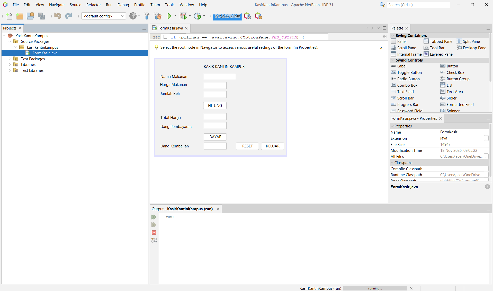

# Aplikasi Kasir Kantin Kampus

## Identitas Mahasiswa
- **Nama:** Dina Permatasari
- **NIM:** C2483207009
- **Kelas:** PTI 5
- **Mata Kuliah:** Pemrograman Visual
- **Dosen Pengampu:** Taofik Muhammad, M.Kom

## Deskripsi Aplikasi
Aplikasi Kasir Kantin Kampus merupakan aplikasi desktop sederhana yang dibuat menggunakan Java Swing di Apache NetBeans IDE. Aplikasi ini digunakan untuk membantu proses transaksi penjualan makanan dan minuman di kantin kampus.

Aplikasi dapat menghitung total harga, menerima pembayaran, menghitung uang kembalian, serta memberikan peringatan apabila pembayaran kurang atau input tidak valid.

## Fitur Aplikasi
1. Input nama makanan atau minuman.
2. Input harga satuan.
3. Input jumlah pembelian.
4. Menghitung total harga secara otomatis.
5. Menghitung uang kembalian.
6. Validasi input.
7. Tombol Reset untuk mengosongkan data.
8. Tombol Keluar untuk menutup aplikasi.

## Komponen Java Swing
- JFrame
- JPanel
- JLabel
- JTextField
- JButton
- JOptionPane

## Teknologi
- Bahasa pemrograman: Java
- GUI: Java Swing
- IDE: Apache NetBeans
- Database: Tidak menggunakan database.

## Screenshot Aplikasi

### 1. Tampilan Utama

### 2. Hasil Perhitungan Total

### 3. Hasil Pembayaran dan Kembalian

## Cara Menjalankan Aplikasi
1. Buka Apache NetBeans IDE.
2. Pilih File → Open Project.
3. Pilih folder KasirKantinKampus.
4. Tunggu sampai project selesai dimuat.
5. Buka package `kasirkantinkampus`.
6. Jalankan file `FormKasir.java`.

## Pengujian Aplikasi
Aplikasi diuji menggunakan tiga data transaksi:
- Nasi Goreng: Total Rp30.000, kembalian Rp20.000.
- Mie Ayam: Total Rp36.000, kembalian Rp4.000.
- Es Teh: Total Rp20.000, pembayaran kurang Rp10.000.

## Penutup
Aplikasi Kasir Kantin Kampus dibuat untuk memenuhi tugas Ujian Tengah Semester mata kuliah Pemrograman Visual.

